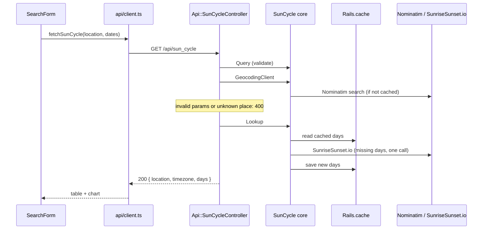

# sunsapp

Type a place and a date range, and see the sunrise, sunset and evening golden hour of every day, in the local time of that place.

## Features

- Any place name: the backend geocodes it with [Nominatim](https://nominatim.org/) (OpenStreetMap).
- Sun times from [SunriseSunset.io](https://sunrisesunset.io/api/), in 24-hour local time with the zone shown (for example `America/Santiago (UTC−3)`), DST (daylight saving time) changes included.
- A table and a Chart.js chart on a fixed 00:00–24:00 axis; polar days and nights show as "—" and gaps.
- Ranges of up to 366 days. Sun times and geocoding results are cached for 30 days with `Rails.cache`, so repeated searches don't call the external APIs again.
- Input validation with clear 400 messages, and 500 errors that never leak internal details.

## Quick start

With Docker:

```bash
docker compose up
```

Open http://localhost:3001. The API runs on http://localhost:3000.

Without Docker you need Ruby 4.0.7 (`backend/.ruby-version`) and Node 24 (`frontend/.nvmrc`):

```bash
# Terminal 1: backend on :3000
cd backend
bundle install
bin/rails db:prepare
bin/rails server

# Terminal 2: frontend on :3001
cd frontend
npm ci
npm run dev
```

The frontend reads the API URL from `VITE_API_URL` (default `http://localhost:3000`), and the backend accepts browser calls only from `CORS_ORIGINS` (default `http://localhost:3001`). See `frontend/.env.example` and `backend/.env.example`.

## Repository map

```
sunsapp/
├── backend/                      Rails 8.1 API (Ruby 4.0)
│   ├── app/controllers/api/      sun_cycle_controller.rb: wires the core and renders JSON
│   ├── app/core/sun_cycle/       query.rb (validates), lookup.rb (cache + fetch),
│   │                             sunrise_sunset_client.rb, geocoding_client.rb
│   └── test/                     mirrors app/; WebMock blocks the network
├── frontend/                     React 19 + TypeScript strict (Vite)
│   └── src/
│       ├── components/           SearchForm, Results, ResultsChart, ErrorMessage, LoadingScreen
│       ├── api/                  client.ts and types.ts: the only place that knows the API URL
│       ├── lib/                  pure functions: time parsing and chart data
│       └── App.tsx               the screen and its state
├── docs/                         api.md, architecture.md, adr/
├── .github/workflows/            backend.yml and frontend.yml (CI)
├── .claude/skills/               Claude Code project skills
└── compose.yml                   local development with Docker
```

The code flows one way: **component → API client → controller → core → external API**. `SearchForm` calls `fetchSunCycle` in `src/api/client.ts`, which sends `GET /api/sun_cycle` to `Api::SunCycleController`. The controller asks `SunCycle::Query` to validate the params, `SunCycle::GeocodingClient` for the coordinates and `SunCycle::Lookup` for the days; `Lookup` reads `Rails.cache` and asks `SunCycle::SunriseSunsetClient` only for the missing days.



## API

One endpoint. Full contract, limits and error codes in [docs/api.md](docs/api.md).

```http
GET /api/sun_cycle?location=Tokyo&start_date=2026-06-21&end_date=2026-06-21
```

```json
{
  "location": "Tokyo",
  "timezone": "Asia/Tokyo",
  "days": [
    { "date": "2026-06-21", "sunrise": "04:25", "sunset": "19:00", "golden_hour": "18:20", "utc_offset": 540 }
  ]
}
```

Errors are `{ "error": "<message>" }` with status 400, 404 or 500.

## Tests and quality

Tests never hit the network, and both sides fail below 80 % line coverage. CI runs all of this on every pull request.

```bash
# Backend
cd backend
bin/rails test                              # Minitest + WebMock, SimpleCov
bin/rubocop
bin/brakeman --no-pager
bundle exec bundler-audit check --update

# Frontend
cd frontend
npm test                                    # Vitest + Testing Library
npm run test:coverage
npm run lint && npm run typecheck
npm run build                               # production build in dist/
npm audit --audit-level=high
```

## Documentation

- [docs/api.md](docs/api.md): the API contract.
- [docs/architecture.md](docs/architecture.md): components, request flow and folder map.
- [docs/adr/](docs/adr/README.md): architecture decision records, accepted and proposed.
- [backend/README.md](backend/README.md) and [frontend/README.md](frontend/README.md): each part on its own.
- [CHANGELOG.md](CHANGELOG.md): what changed in each version.

## Contributing

The project uses git-flow with rebase & merge, Conventional Commits and one PR (pull request) per task targeting `develop` ([ADR 0002](docs/adr/0002-git-flow-rebase-merge.md)). Branch names, test rules, security rules and the definition of done are in [CLAUDE.md](CLAUDE.md), which applies to people and to Claude Code alike.
