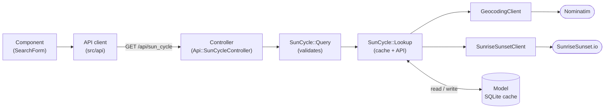

# Architecture

sunsapp takes a location and a date range and shows, for each day, the sunrise, the sunset and the golden hour in a table and a chart.

> The repository reaches this target structure through tasks T3 to T7 of the plan. Until then, the logic still lives in `Api::SunCycleController` and `app/services/sun_cycle_fetcher.rb`, and the frontend is Create React App in JavaScript.

## Components

| Component | Role |
|---|---|
| Frontend (React + TypeScript, Vite) | Search form, results table and chart. Calls the backend through one API client. |
| Backend (Rails 8 API) | `GET /api/sun_cycle`: validates the request, geocodes the location, gets the sun times and caches them. |
| SQLite | Cache of sun times per location and date. |
| Nominatim | Turns a location name into coordinates. |
| SunriseSunset.io | Returns sunrise, sunset and golden hour for coordinates and dates. |

## Request flow

The flow goes one way; the model only stores.



## Folder map

```
backend/
  app/controllers/api/   receives and validates the request, builds the response
  app/core/sun_cycle/    query.rb, lookup.rb, sunrise_sunset_client.rb, geocoding_client.rb
  app/models/            SQLite cache
  test/                  mirrors app/ (controllers, core, models)
frontend/src/
  api/                   HTTP client and SunCycleDay type (only place that knows the URL)
  lib/                   pure functions: time parsing and formatting
  components/            SearchForm, Results, ResultsChart, LoadingScreen, ErrorMessage
  App.tsx                builds the screen and holds the state
```

Why the logic lives in `app/core/sun_cycle/`: see [ADR 0001](adr/0001-monorepo-rails-api-react.md).
