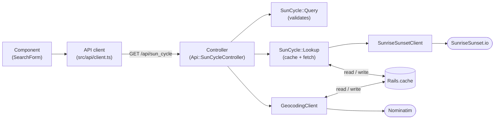

# Architecture

sunsapp takes a location and a date range and shows, for each day, the sunrise, the sunset and the evening golden hour in a table and a chart, in the local time of the place. The API contract is in [api.md](api.md).

## Components

| Component | Role |
|---|---|
| Frontend (React + TypeScript, Vite) | Search form, results table and chart. Calls the backend through one API client. |
| Backend (Rails 8.1 API) | `GET /api/sun_cycle`: validates the request, geocodes the location, gets the sun times and caches them. |
| `Rails.cache` | Solid Cache in production, the memory store in development. Holds one entry per place and day (coordinates rounded to 4 decimals + date) and the successful geocoding results (coordinates and matched name), both for 30 days. |
| Nominatim | Turns a location name into coordinates and the name of the matched place. |
| SunriseSunset.io | Returns sunrise, sunset and golden hour for coordinates and dates. |

There is no table of sun times: everything the app stores is cache and can be lost without harm.

## Request flow

The flow goes one way: component → API client → controller → core → external API.



1. `SunCycle::Query` validates the params; any failure is a 400 before an external call.
2. `SunCycle::GeocodingClient` returns the coordinates and the matched name, from the cache or from Nominatim; no match is a 400.
3. `SunCycle::Lookup` reads each day from the cache and fetches only the missing ones, in one call to SunriseSunset.io (two for 366 days).
4. The controller renders `{ location, timezone, days }`, a 404 when there are no days, or a generic 500.

## Folder map

```
backend/
  app/controllers/api/   sun_cycle_controller.rb: wires the core and renders JSON
  app/core/sun_cycle/    query.rb, lookup.rb, sunrise_sunset_client.rb, geocoding_client.rb
  config/initializers/   cors.rb (CORS_ORIGINS), geocoder.rb (Nominatim), filter_parameter_logging.rb
  test/                  mirrors app/ (controllers, core); WebMock blocks the network
frontend/src/
  api/                   client.ts and types.ts (only place that knows the URL)
  lib/                   pure functions: time.ts (parsing, formatting), chartData.ts
  components/            SearchForm, Results, ResultsChart, ErrorMessage, LoadingScreen
  App.tsx                builds the screen and holds the state
compose.yml              local development: backend :3000, frontend :3001 (Vite dev server)
```

## Environments

- **Local:** `docker compose up`, or `bin/rails server` and `npm run dev` by hand. No nginx; the frontend is the Vite dev server.
- **Production:** not deployed yet. `npm run build` writes a static site to `frontend/dist/`, and `backend/Dockerfile` builds the API image. Where to host them is [ADR 0009](adr/0009-free-deployment.md) (proposed).

Why the logic lives in `app/core/sun_cycle/`: see [ADR 0001](adr/0001-monorepo-rails-api-react.md). All decisions: [ADR index](adr/README.md).
